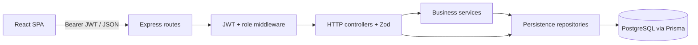
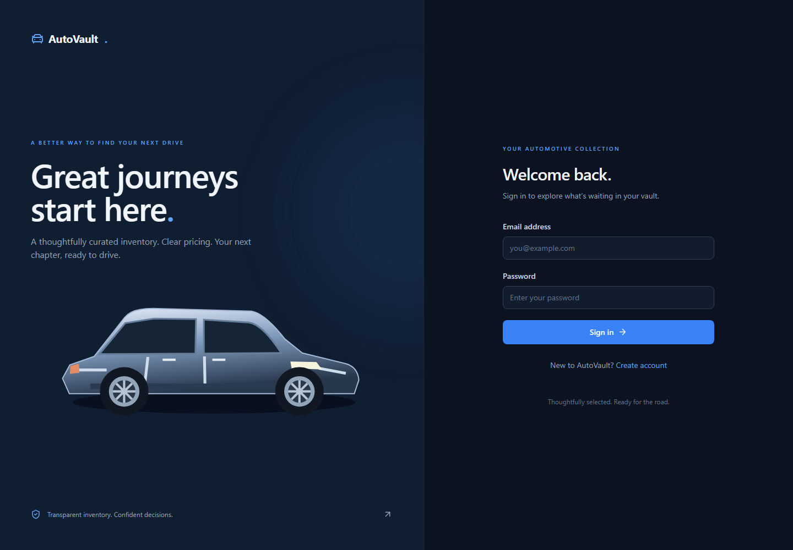
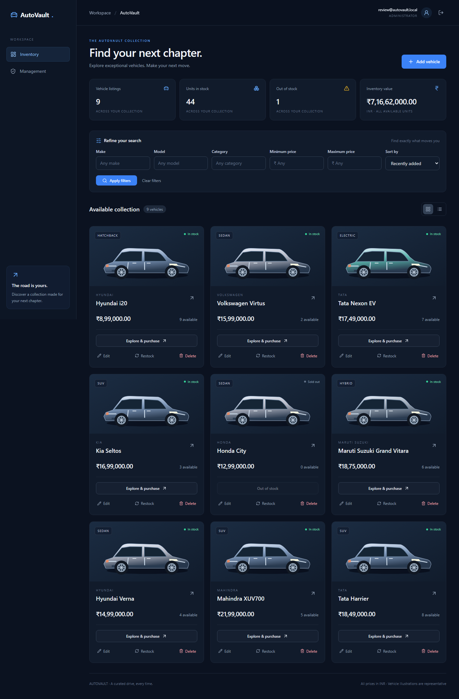
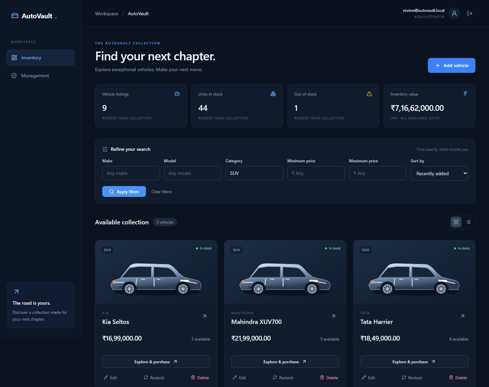
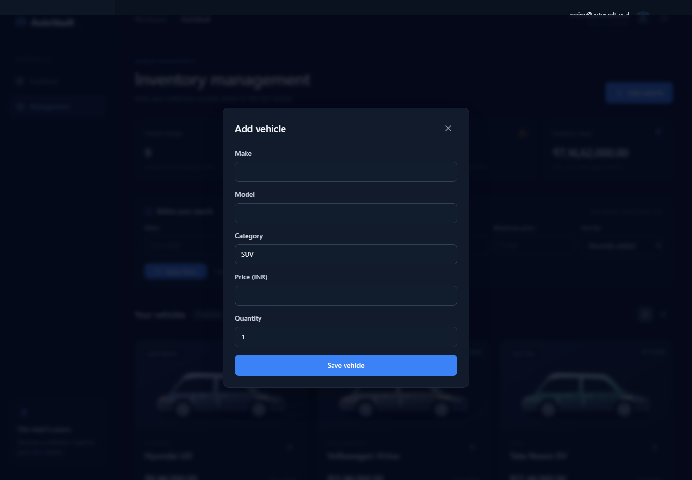
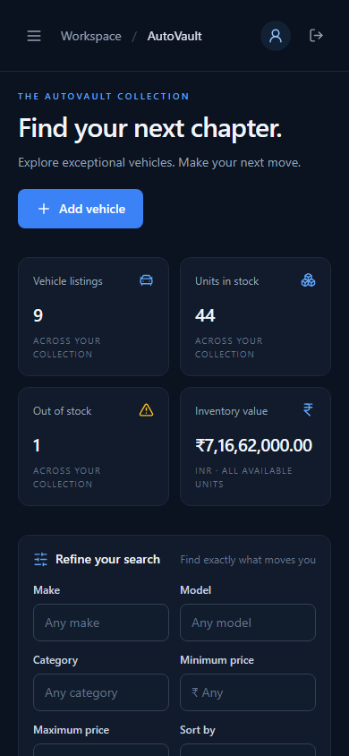

# AutoVault

A responsive dealership inventory system with PostgreSQL-backed stock, role-based administration, and transaction-safe purchasing. Built as an original full-stack technical evaluation project with genuine test-first backend commits.

## What it does

- Register and sign in; public accounts are always USER.
- Browse all vehicles, including sold-out listings; filter by make, model, category and inclusive price range.
- Stable sorting, pagination, exact inventory totals, vehicle details and grid/list views.
- Confirm multi-unit purchases and refresh inventory from the server.
- ADMIN-only create, edit, restock and delete with confirmation.
- Responsive navigation, keyboard-operable dialogs, loading/empty/error states, and local original SVG illustrations.
- Prices are stored as PostgreSQL numeric values and displayed in INR. This is an inventory purchase record, not a payment gateway or delivery workflow.

## Stack and architecture

Node.js 22 LTS, TypeScript, Express 5, PostgreSQL 17, Prisma 6, Zod 4, bcrypt and signed JWTs. React 19, Vite, React Router, TanStack Query, React Hook Form, Tailwind CSS and Lucide power the SPA. Vitest/V8, Supertest, React Testing Library and Playwright verify behavior. The lockfile pins the resolved versions.

Prisma supplies typed persistence and transactions; PostgreSQL supplies exact decimal arithmetic, constraints and row locks. Zod rejects unknown writable fields. TanStack Query invalidates server data only after successful writes. No live UI inventory is mocked.



Simple CRUD goes directly from controller to repository; inventory and authentication business rules use services. This avoids empty forwarding layers. Transaction ownership is centralized in the locked-vehicle repository helper.

## Repository

```text
apps/
  api/
    prisma/{schema.prisma,migrations/,seed.ts}
    src/{config,controllers,services,repositories,routes,middleware,validators,utils}/
    src/{app.ts,server.ts}
    tests/{auth,vehicles,search,inventory,security}.test.ts
  web/
    src/{components,pages,features,services,contexts,types,tests}/
    src/{App.tsx,main.tsx,styles.css}
docs/{EXECUTION_PLAN.md,TEST_REPORT.md,evidence/}
e2e/{setup.ts,flows.spec.ts}
scripts/dev.mjs
screenshots/
.env.example
docker-compose.yml
playwright.config.ts
PROMPTS.md
package.json
```

## Prerequisites

- Node 22.13+ LTS (or supported Node 24 LTS), npm 10+ and Git.
- Docker Desktop running Linux containers; approximately 3 GB free disk and sufficient free RAM for PostgreSQL, builds and Chromium.
- Ports 5432/5433 for development/test databases; 4000/5173 for development API/web; 4001/5174 for E2E.

The evaluation host initially had a full C: drive. With user authorization the project moved to **D:\Codex\AutoVault**. Its untracked local npm cache, runtime and browser downloads live in work/. These machine-specific paths are not needed for a fresh clone.

## Local setup

From the repository root:

```sh
npm install
cp .env.example .env
# Replace JWT_SECRET with at least 32 random characters.
# Example: node -e "console.log(require('crypto').randomBytes(48).toString('hex'))"
docker compose up -d --wait
npm run db:migrate
npm run db:seed
npm run dev
```

PowerShell users can use `Copy-Item .env.example .env`. Open [AutoVault](http://localhost:5173). The API is at [health](http://localhost:4000/api/health). Vite proxies /api to the API, so browser requests remain same-origin.

The development database uses a named persistent volume. The test database is a separate PostgreSQL instance on port 5433. Do not use `docker compose down -v` unless you intend to delete development data. The seed inserts nine vehicles with stable IDs and preserves existing quantities when rerun.

### Environment

| Variable                     | Purpose                                                               |
| ---------------------------- | --------------------------------------------------------------------- |
| DATABASE_URL                 | Development/production PostgreSQL connection                          |
| TEST_DATABASE_URL            | Optional test URL; must be localhost or 127.0.0.1:5433/autovault_test |
| JWT_SECRET                   | Required secret, minimum 32 characters; never committed               |
| FRONTEND_ORIGIN              | Explicit allowed origin; defaults to http://localhost:5173            |
| PORT                         | API port, default 4000                                                |
| NODE_ENV                     | development, test or production                                       |
| ADMIN_EMAIL / ADMIN_PASSWORD | Optional development-only admin bootstrap                             |
| API_TARGET                   | Vite API proxy target; used by E2E on port 4001                       |

### Administrator bootstrap

Set ADMIN_EMAIL and ADMIN_PASSWORD in your local .env, using a strong unique password, and run `npm run db:seed`. Remove these values afterwards. No default administrator password exists. The seed refuses to run in production and refuses to promote an existing public USER account. Existing ADMIN passwords are not reset on reruns. For production, provision the initial administrator through a reviewed, restricted operational database procedure using a bcrypt cost-12 hash; the development bootstrap is intentionally unavailable.

### Commands

| Command               | Result                                                          |
| --------------------- | --------------------------------------------------------------- |
| npm run dev           | Starts API and Vite together with shutdown coordination         |
| npm run build         | Compiles API to apps/api/dist and web to apps/web/dist          |
| npm run lint          | ESLint across source, configuration and tests                   |
| npm run typecheck     | Type-checks both application source trees                       |
| npm run test          | PostgreSQL backend and browser-DOM frontend tests               |
| npm run test:coverage | V8 coverage; backend statements/branches must reach 85%         |
| npm run test:e2e      | Playwright real-browser integration flows                       |
| npm run db:migrate    | Applies committed migrations to DATABASE_URL                    |
| npm run db:seed       | Non-destructive development fixtures / optional admin bootstrap |
| npm run db:studio     | Opens Prisma Studio                                             |
| npm run format        | Formats source and documentation with Prettier                  |

## API

All vehicle routes require `Authorization: Bearer <token>`. Public registration never accepts role, id or passwordHash fields. JWTs contain a user ID, expire after 15 minutes, and verify HS256, issuer and audience. The server fetches the current user role on every protected request.

| Method | Endpoint                   | Authorization        | Result                                                     |
| ------ | -------------------------- | -------------------- | ---------------------------------------------------------- |
| GET    | /api/health                | Public               | Database health, 200                                       |
| POST   | /api/auth/register         | Public, rate limited | Safe user + JWT, 201                                       |
| POST   | /api/auth/login            | Public, rate limited | Safe user + JWT, 200                                       |
| GET    | /api/vehicles              | USER / ADMIN         | Paginated inventory                                        |
| GET    | /api/vehicles/search       | USER / ADMIN         | Filtered paginated inventory                               |
| GET    | /api/vehicles/summary      | USER / ADMIN         | Global listings, units, sold-out count, value              |
| POST   | /api/vehicles              | ADMIN                | Created vehicle, 201                                       |
| PUT    | /api/vehicles/:id          | ADMIN                | Full replacement of writable vehicle fields, 200           |
| DELETE | /api/vehicles/:id          | ADMIN                | Confirmation, 200; 409 when purchase history references it |
| POST   | /api/vehicles/:id/purchase | USER / ADMIN         | Purchase record and updated vehicle, 201                   |
| POST   | /api/vehicles/:id/restock  | ADMIN                | Updated vehicle, 200                                       |

Registration example (replace credentials with your own):

```json
{ "email": "driver@example.com", "password": "YourOwnStrongPassword123!" }
```

Response shape:

```json
{
  "user": { "id": "UUID", "email": "driver@example.com", "role": "USER" },
  "token": "SIGNED_JWT"
}
```

Create/update request:

```json
{
  "make": "Tata",
  "model": "Harrier",
  "category": "SUV",
  "price": "1849000.25",
  "quantity": 8
}
```

Vehicle responses include id, the writable fields, createdAt and updatedAt. Decimal prices are serialized as strings to preserve exactness. Numeric JSON prices are accepted when valid, but decimal strings are recommended.

Search example:

```text
GET /api/vehicles/search?make=ta&category=suv&minPrice=1000000&maxPrice=2500000&page=1&pageSize=9&sort=priceAsc
```

Response: `{items:[...],total:1,page:1,pageSize:9,totalPages:1}`. Sort values: newest, priceAsc, priceDesc, make. UUID provides a stable tie-breaker. Page size is capped at 100. No matches returns an empty items array and totalPages:0. Search and summary routes precede parameter routes.

Purchase request `{"quantity":2}` (or `{}` for one) returns `{vehicle:{...quantity:6},purchase:{id,userId,vehicleId,unitPrice,quantity,purchasedAt}}`. Restock requires a positive integer quantity and returns the updated vehicle.

Errors use `{error:{message:"...",details:[{path,message}]}}` (details only for validation). Status codes include 400 validation, 401 missing/invalid/expired login, 403 forbidden, 404 absent records/routes, 409 duplicate/stock/history conflict, 413 oversized bodies and 500 unexpected errors. Invalid login messages are identical for unknown users and incorrect passwords.

## Stock consistency and money

Purchasing starts a PostgreSQL transaction, selects the vehicle `FOR UPDATE`, checks availability, decrements quantity and inserts the price snapshot before committing. Competing purchasers serialize on the row lock. Exactly one can buy the last unit; the next receives 409. Restocking uses the same lock and guards integer overflow. If inserting the purchase fails, stock rolls back. The tests inject an actual PostgreSQL trigger failure to verify this.

Ordinary UPDATE and DELETE also acquire PostgreSQL row locks. Absolute administrator quantity edits are intentional stock corrections with last-writer-wins semantics in lock order; an edit after a purchase may replace the remaining quantity. The UI warns about absolute replacement; use Restock for increments. Optimistic version checking is a future improvement for competing administrators.

Prices use numeric(14,2), snapshots retain exact unit prices, and summary value is calculated with SQL decimal multiplication. Frontend multi-unit totals use integer paise (BigInt). Number conversion is used only for localized display, never persisted calculations. Purchase retries are not automatically attempted and idempotency keys are not implemented; a lost successful response requires reconciliation before retrying.

## Security decisions and tradeoffs

- Only administrators can mutate inventory except purchases. This policy is enforced on the server, not merely hidden in navigation.
- bcrypt cost 12; strong registration passwords and UTF-8 byte-length bound prevent silent bcrypt truncation.
- Strict Zod object schemas, UUID checks, bounded lengths, positive decimal prices, nonnegative integer stock and database CHECK constraints.
- SQL interpolation uses Prisma parameterization. Case-insensitive partial-search GIN trigram indexes and common sort indexes are migrated.
- Helmet headers, explicit CORS, 16 KB JSON limit, auth rate limiting (50 attempts / 15 minutes / IP), generic unexpected-error responses.
- JWT stored in sessionStorage for this SPA; it survives reloads but remains accessible to same-origin script. Use strong CSP at the static host and prevent XSS. No refresh tokens; sign in again after expiration. Logout removes the local token; issued tokens remain usable until expiry.
- The in-process rate limiter suits one API instance. Use a shared store and verified proxy configuration when scaling; the API does not blindly trust proxy headers.
- Database ports bind only to localhost in Compose. Demo database passwords are local setup values, not production credentials.
- Purchases prevent hard deletion of referenced vehicles, preserving audit history. Soft deletion and purchase-history UI are future work.
- No payment processing, password reset, email verification, MFA or production deployment is claimed.

## Testing and genuine TDD

Start both Compose databases. Root test scripts automatically apply migrations through a guarded local-test-only script. To apply the test migration explicitly and run verification:

```sh
npm run db:test:migrate
npm run test
npm run test:coverage
npx playwright install chromium
npm run test:e2e
```

The E2E pre-script builds both applications before launching the isolated servers. Integration setup validates the host, port and exact database name before cleanup. E2E uses the same fixed isolated database and resets only its fixtures. **Do not run backend and E2E tests concurrently.** Production and development data are not cleaned by the tests.

Backend tests exercise the real PostgreSQL constraints, transactions and API with Supertest. Frontend tests mock only the HTTP boundary. E2E exercises the built UI, API and PostgreSQL in Chromium. Screenshots and traces from failing E2E runs are ignored by Git.

Actual measured results and commands are in [TEST_REPORT](docs/TEST_REPORT.md); raw terminal evidence is in [docs/evidence](docs/evidence). The initial verified result was 64 backend and 11 frontend tests, plus 4 E2E flows; additional boundary regressions were subsequently added. The final counts and measurements are in TEST_REPORT.md. Backend coverage exceeded both 85% gates. Frontend coverage is reported honestly, with uncovered management/dialog branches rather than an invented target achievement.

| Behavior                | RED commit | GREEN commit | Observed RED                       |
| ----------------------- | ---------- | ------------ | ---------------------------------- |
| Authentication          | 59b9a06    | 56be36d      | 7 failures                         |
| JWT/roles and CRUD      | 6b12a8d    | 2fedc2f      | 22 failures, 1 incidental 404 pass |
| Search and summary      | 2f127b9    | a536ca2      | 14 failures                        |
| Purchase/restock        | 9db87d5    | 2d42aaf      | 13 failures, 1 incidental 404 pass |
| Security/error handling | 8b99748    | 001f222      | 4 failures, 2 existing passes      |
| React behaviors         | e3e0c94    | bc33212      | 11 failures                        |

Infrastructure was committed first (4592d92). Formatting and removal of an unused query were committed separately (27da93b). The first purchase implementation failed the race test with a transaction acquisition timeout; the bounded wait was corrected before the GREEN commit. Test-runner setup failures are documented as setup failures, not manufactured RED evidence. Git timestamps were not altered. All AI-assisted commits carry the requested co-author trailer.

## Screenshots

The following are actual Chromium captures from the running application with PostgreSQL seed data, not generated mockups. Vehicle illustrations inside the application are original SVG artwork and intentionally representative.







## Deployment

1. Provision PostgreSQL 17 and a restricted application database user. Ensure the migration role can install pg_trgm (or have an operator provision it).
2. Set production DATABASE_URL, random JWT_SECRET, NODE_ENV=production and the exact FRONTEND_ORIGIN through a secret manager.
3. Run `npm ci`, `npm run db:migrate`, then `npm run build`. Do not run the development seed in production.
4. Run `node apps/api/dist/server.js` under a process supervisor. It binds to loopback; place the reverse proxy on the same host. If containerizing the API, deliberately adapt the bind interface and network policy.
5. Serve apps/web/dist over HTTPS, proxy /api to 127.0.0.1:4000, and fall back non-file SPA routes to index.html. Add a strict CSP suitable for the static assets. Do not use Vite's development server as a production server.
6. Configure database backups, restore drills, log monitoring, migration rollback planning and a shared rate-limit store before scaling. Use health checks. A successful local build is not evidence of a deployed service.

## Troubleshooting

- ENOSPC: free space or place checkout/cache/browser downloads on a drive with capacity. Never delete unrelated user files.
- Docker pipe/daemon error: start Docker Desktop and ensure Linux containers are running.
- Database connection error: confirm containers are healthy and ports match .env; apply migrations before boot.
- Test safety refusal: use only the exact dedicated local test instance. Do not weaken the guard for production URLs.
- JWT configuration error: provide a random secret of at least 32 characters. Never copy the test secret into production.
- 409 deletion: a purchased vehicle is retained for history. 409 purchase: refresh inventory; another buyer may have consumed stock.
- 401 after 15 minutes: sign in again; no refresh-token flow is implemented.
- Browser binary missing: run `npx playwright install chromium`. A custom PLAYWRIGHT_BROWSERS_PATH must be used consistently at install and run time.
- Low-memory host: run tests/builds/browser verification sequentially and close unneeded applications yourself. The dev launcher limits worker concurrency; no unrelated process is automatically terminated.
- After switching major dependencies, use a clean `npm ci` to avoid stale workspace installs. Keep the lockfile committed.

## My AI Usage

OpenAI Codex / ChatGPT assisted with architecture, test design, implementation, debugging, local command execution, browser automation, documentation and review. The assistant executed real RED/GREEN tests and captured actual tool outputs. The user supplied the assignment and explicitly authorized moving the project to D: after C: filled up. **No human code review, manual acceptance test, or production verification has been claimed.**

The main value of the assistance was iterating across database, API and UI boundaries; the real concurrency test found a timeout that a superficial mocked test would have missed. Automated passing tests do not replace an independent security review, accessibility audit or deployment validation. An authentic conversation share link is recorded in [PROMPTS.md](PROMPTS.md). The sharing tool reports a workspace audience; access by public repository visitors is not verified. The link is a snapshot created before this documentation update, not a fabricated or reconstructed transcript.

## Publish to GitHub

Public repository: [anitej299/autovault](https://github.com/anitej299/autovault). The original TDD history is preserved. PROMPTS.md contains the authentic conversation share link; its workspace audience may limit access for public visitors.

To publish a separate copy under your own account, create an empty public repository and run:

```sh
git branch -M main
git remote add origin https://github.com/YOUR_USERNAME/autovault.git
git push -u origin main
```

Inspect staged files for secrets before publishing. No license is added because a license choice was not requested.
